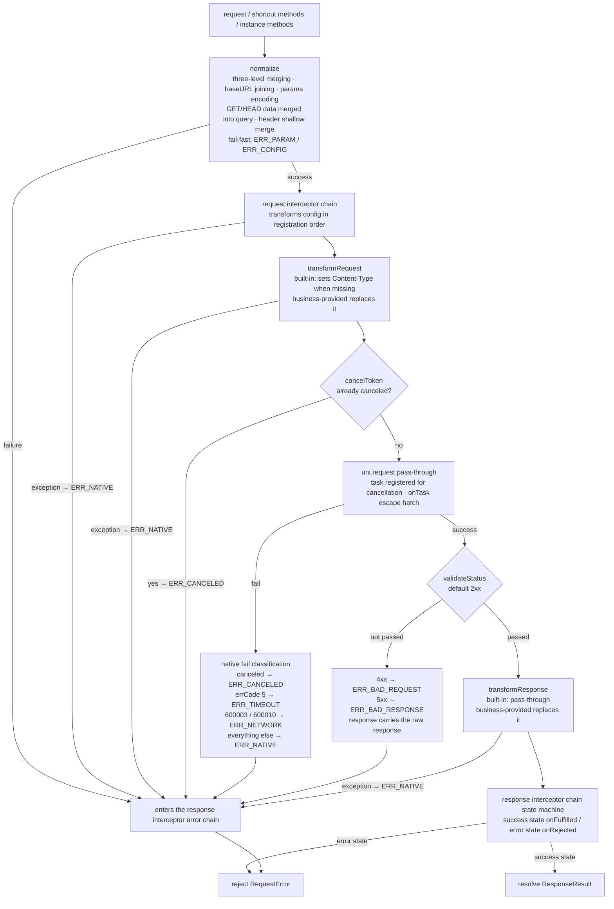

# Request Flow

This is the only page that goes deep into the implementation: it breaks down the complete internal pipeline of a request from `request(config)` to resolve / reject. Once you understand it, the behavior of [Interceptors](./interceptors), the classification in [Error Handling](./error-handling), and everything you see in `response.config` all become predictable.

## The Full Pipeline

> The default instance and `createRequest` instances share the same pipeline; the only differences are each one's own defaults and interceptor registry.

## Stage 1: Config Normalization (normalize)

The merge order is strictly: **built-in defaults → instance defaults → request-level config**.

1. **url validation**: if `url` is empty after trimming whitespace → fail-fast `ERR_PARAM`, no network request;
2. **scalar merging**: `method` (default GET), `timeout` (default 60000), `validateStatus` (default 2xx) — a request-level value overrides; `baseURL` takes the request-level value first, otherwise the instance default;
3. **header shallow merge**: the instance default header lays the base, request-level same-name keys override, written into a brand-new object;
4. **baseURL joining**: urls starting with `http://` / `https://` are used as-is; relative paths are joined with the two-sided slash-tolerance rule; a relative path without baseURL → fail-fast `ERR_CONFIG`;
5. **params encoding**: `params` is encoded deterministically in-library (`encodeURIComponent`, rules in [Params & Headers](./params-and-headers)) and correctly joined to the url's existing query with `?` / `&`;
6. **GET/HEAD special handling**: when `data` is a `UTSJSONObject` it is encoded into the query (after params), then `data` is set to `null`.

## Stage 2: The Request Interceptor Chain

config is transformed layer by layer in registration order; each layer's return value is the next layer's input. An exception inside an interceptor is treated as a chain bug: the library catches it and turns it into `ERR_NATIVE` (errMsg 「请求拦截器执行异常」), and the chain continues down the error path.

Precisely because it runs after normalization, the config an interceptor sees is the "predecessor of the send snapshot": url complete, params cleared, GET/HEAD data already null.

## Stage 3: transformRequest and Pre-Send Checks

- `transformRequest`: business-provided replaces the built-in; the built-in behavior is "when data is a `UTSJSONObject` and content-type is not explicitly set, set `application/json`";
- **Cancellation pre-check**: a mounted `cancelToken.canceled === true` → `ERR_CANCELED` directly, no network request.

## Stage 4: uni.request Pass-Through

All parameters (method / data / header / timeout / dataType / responseType / enableQuic / sslVerify / withCredentials / firstIpv4 / enableChunked) are **passed through in full**; `null` lets the native layer apply its defaults. This is the only adapter convergence point in the whole library:

- After getting the native `RequestTask`, it is registered in the cancellation registry (for `cancel()`'s deterministic abort) and deregistered when the request reaches a terminal state;
- The `onTask` escape hatch is called back after that and does not affect registration.

## Stage 5: Failure Classification (fail)

Native fail callbacks are classified by deterministic mapping (evaluated in order):

| Condition | Result |
| --- | --- |
| Token already canceled | `ERR_CANCELED` (errMsg carries the cancel reason) |
| Native `errCode == 5` | `ERR_TIMEOUT` |
| Native `errCode == 600003` or `600010` | `ERR_NETWORK` |
| Everything else | `ERR_NATIVE` |

`nativeErrCode` always passes through the original native value.

## Stage 6: Status Code Validation (validateStatus)

The success callback does not mean business success: the default validation is 2xx (`>= 200 && < 300`, overridable by instance defaults or the request level). When it fails:

- `statusCode < 500` → `ERR_BAD_REQUEST`; `statusCode >= 500` → `ERR_BAD_RESPONSE`;
- The error's `response` field carries the complete raw response (statusCode / header / cookies / **body** / config).

## Stage 7: transformResponse and the Response Interceptor Chain

`transformResponse` runs only after validateStatus passes (the built-in is pass-through; exceptions become `ERR_NATIVE`). Then the response interceptor chain state machine takes over:

- **Success state**: each interceptor's `onFulfilled` runs in turn; an exception switches to the error state (`ERR_NATIVE`);
- **Error state**: each `onRejected` runs in turn — returning a response object **recovers** to the success state, returning a RequestError **replaces the error**, returning `null` **passes through**;
- **Upstream errors also enter the error chain**: normalization failures, request interceptor exceptions, transformRequest exceptions, pre-send cancellation, network fail, and HTTP errors all converge into the same state machine (Axios-identical semantics).

## The Normalized Output Is the Send Snapshot

The config the pipeline finally hands to `uni.request` is the normalized output, and `response.config` / `error.config` hold exactly it:

- `config.url` is the **fully joined address** (with all query);
- `config.params` is `null` (encoded into the url);
- GET/HEAD `config.data` is `null`;
- `config.header` is the merged result.

So to debug "what the request actually looked like", just look at `res.config.url`; this also explains why rewriting `params` inside an interceptor has no effect — see [FAQ](./faq).
