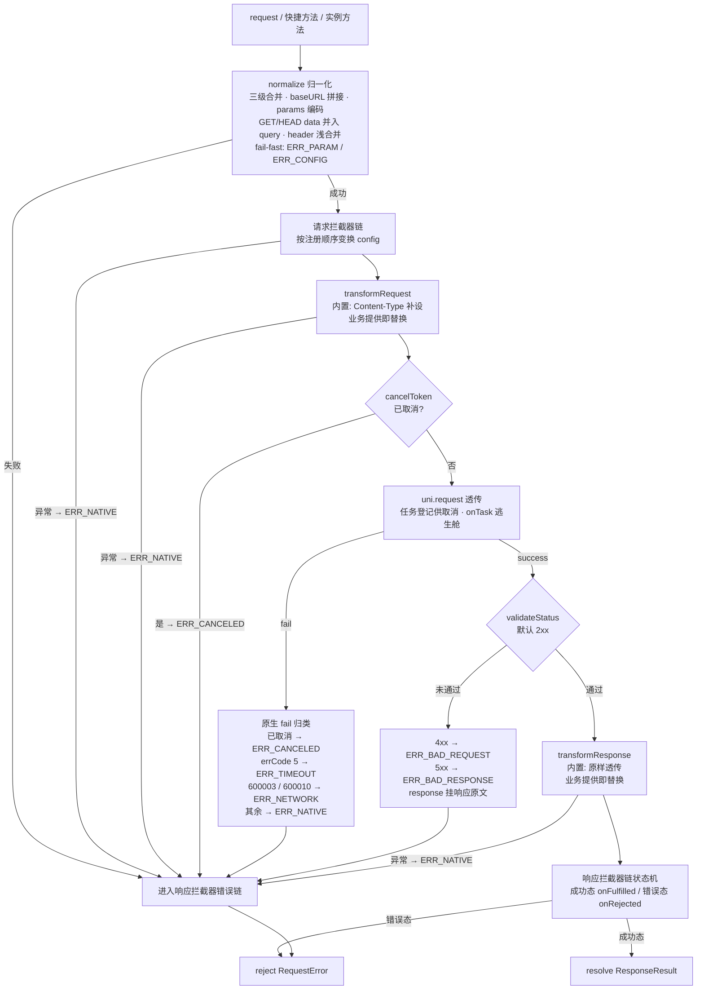

# 请求流程原理

本篇是唯一深入实现的篇目：拆解一次请求从 `request(config)` 到 resolve / reject 的完整内部管线。理解它之后，[拦截器](./interceptors)的行为、[错误处理](./error-handling)的归类、`response.config` 里看到的一切都变得可预测。

## 全景管线

> 默认实例与 `createRequest` 实例共用同一条管线，差异只在各自持有的 defaults 与拦截器注册表。

## 阶段一：配置归一化（normalize）

合并顺序严格为：**内置默认 → 实例 defaults → 请求级配置**。

1. **url 校验**：`url` 去除空白后为空 → fail-fast `ERR_PARAM`，不发网络；
2. **标量合并**：`method`（默认 GET）、`timeout`（默认 60000）、`validateStatus`（默认 2xx）请求级有值即覆盖；`baseURL` 请求级优先，否则取实例默认；
3. **header 浅合并**：实例默认 header 铺底，请求级同名键覆盖，写入全新对象；
4. **baseURL 拼接**：`http://` / `https://` 开头的 url 原样使用；相对路径按双侧斜杠容错规则拼接；相对路径且无 baseURL → fail-fast `ERR_CONFIG`；
5. **params 编码**：`params` 经库内确定性编码（`encodeURIComponent`，规则见[参数与请求头](./params-and-headers)），与 url 既有 query 以 `?` / `&` 正确续接；
6. **GET/HEAD 特殊处理**：`data` 为 `UTSJSONObject` 时编码并入 query（排在 params 之后），随后 `data` 置 `null`。

## 阶段二：请求拦截器链

按注册顺序逐层变换 config，任一层的返回值作为下一层的输入。拦截器内抛出的异常视为链路 bug，库内捕获转 `ERR_NATIVE`（errMsg「请求拦截器执行异常」），链路继续走错误路径。

正因为运行在归一化之后，拦截器看到的 config 是「发送快照的前身」：url 已完整、params 已清空、GET/HEAD data 已为 null。

## 阶段三：transformRequest 与发送前检查

- `transformRequest`：业务提供即替换内置；内置行为是「data 为 `UTSJSONObject` 且未显式设置 content-type 时补设 `application/json`」；
- **取消预检**：挂载的 `cancelToken.canceled === true` → 直接 `ERR_CANCELED`，不发网络。

## 阶段四：uni.request 透传

全部参数（method / data / header / timeout / dataType / responseType / enableQuic / sslVerify / withCredentials / firstIpv4 / enableChunked）**全量透传**，`null` 交由原生取默认。这里是全库唯一的 adapter 收敛点：

- 拿到原生 `RequestTask` 后登记进取消注册表（供 `cancel()` 确定性 abort），请求到达终态时注销；
- `onTask` 逃生舱在此之后回调，不影响登记。

## 阶段五：失败归类（fail）

原生 fail 回调按确定性映射归类（按序判定）：

| 条件 | 结果 |
| --- | --- |
| token 已取消 | `ERR_CANCELED`（errMsg 携带 cancel reason） |
| 原生 `errCode == 5` | `ERR_TIMEOUT` |
| 原生 `errCode == 600003` 或 `600010` | `ERR_NETWORK` |
| 其余 | `ERR_NATIVE` |

`nativeErrCode` 一律透传原生原值。

## 阶段六：状态码校验（validateStatus）

success 回调不等于业务成功：默认校验为 2xx（`>= 200 && < 300`，可被实例默认或请求级覆盖）。未通过时：

- `statusCode < 500` → `ERR_BAD_REQUEST`；`statusCode >= 500` → `ERR_BAD_RESPONSE`；
- 错误的 `response` 字段挂载完整响应原文（statusCode / header / cookies / **body** / config）。

## 阶段七：transformResponse 与响应拦截器链

`transformResponse` 仅在 validateStatus 通过后执行（内置为原样透传，异常转 `ERR_NATIVE`）。随后进入响应拦截器链状态机：

- **成功态**：依次执行各拦截器的 `onFulfilled`；抛异常转错误态（`ERR_NATIVE`）；
- **错误态**：依次执行 `onRejected`——返回响应对象**恢复**成功态、返回 RequestError **换错**、返回 `null` **放行**；
- **前段错误同样进入错误链**：归一化失败、请求拦截器异常、transformRequest 异常、发送前取消、网络 fail、HTTP 错误，全部汇入同一个状态机（Axios 同款语义）。

## 归一化产物即发送快照

管线最终交给 `uni.request` 的配置是归一化产物，`response.config` / `error.config` 持有的就是它：

- `config.url` 为**拼接完成的完整地址**（含全部 query）；
- `config.params` 为 `null`（已编码进 url）；
- GET/HEAD 的 `config.data` 为 `null`；
- `config.header` 为合并结果。

因此排查「请求到底发成了什么样」，直接看 `res.config.url` 即可；这也解释了拦截器中改写 `params` 无效的原因——见[常见问题](./faq)。
